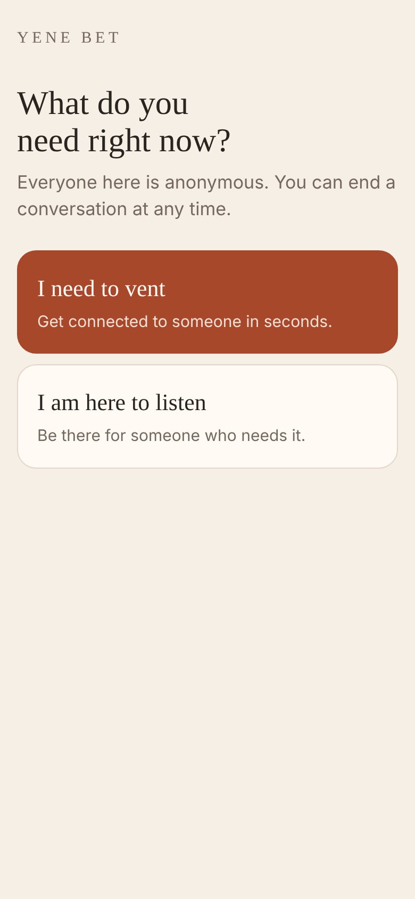

# My Home (YENE BET)

Vent anonymously to someone who is free right now and can relate. One pool of
people, reachable from a website and a Telegram bot.

- Pick a side each time: **I need to vent** or **I am here to listen**.
- A venter writes a line or two and is connected to the best available
  listener (most shared topics, then longest waiting), or picks from up to three.
- If nobody is free and an AI key is set, a clearly labelled AI listener starts
  at once and a real person is offered as soon as one is available; that person
  sees the first message only, never the conversation with the AI.
- Without an AI key nothing pretends to listen: the venter is told nobody is
  free yet, can keep writing, and whoever joins sees it all.
- Each person can reopen their own past conversations for 30 days and remove
  them sooner. The start screen shows how many people are listening and waiting.
- Matching is on specific experiences (losing a parent, a breakup, losing a
  job...), found in what people write. Listeners save their story once.
- After a conversation the venter answers "Did you feel heard?", which thanks
  the listener and shapes who is chosen next time.
- Listeners on Telegram stay available for 24 hours after one tap, and offers
  that are missed do not drop them (two in a row do).
- When someone is waiting and nobody is free, anyone on Telegram who has used
  the bot is asked, in waves (3, then 5 after 30 seconds, then 5 after 2
  minutes), best fit first. People are told when they join; every message has
  "I can listen", "Not now" (quiet for 2 hours) and "Stop these". At most 3 a
  day per person, 30 minutes apart; people who blocked the bot are never
  messaged again. A scheduled function (`netlify/functions/tick.mjs`) runs the
  later waves every minute.
- Shared stories: anonymous posts others answer with "I have been there"; the
  author can invite one of them to talk. Two people who both choose "talk
  again" can reach each other later.
- Text only. No accounts, names or phone numbers.

 

## Run it locally

Needs Node 20+ and a Postgres database.

```bash
npm install
```

```bash
cp .env.example .env.local
```

Set `DATABASE_URL` in `.env.local`, then create the tables:

```bash
DATABASE_URL=postgres://... npm run migrate
```

Each migration file runs once; what has run is recorded in `schema_migrations`.

```bash
npm run dev
```

Open http://localhost:3000 in two browser windows (use a private window for
the second, so it is a different anonymous person).

## Stats

`/stats` is a private page showing how the app is used: people who joined and
are active, conversations and how many reached a person, how long people waited,
listeners available, Telegram reach, and ratings. Totals only, never messages.
It asks for `ADMIN_SECRET` (set it in the environment; it is separate from
`CRON_SECRET`). The same numbers are at `/api/stats` with the secret as a bearer
token. Identities used for testing can be marked with `people.is_test` and are
left out. "Active per day" is recorded once a day by the background job, so its
history starts when the page was added.

## Tests

```bash
DATABASE_URL=postgres://.../test_db npm test
```

Covers matching order, many venters at once never sharing a listener, the AI
fallback and handoff, Telegram flows against a stand-in Telegram API, crisis and
contact checks, reports, blocking and cleanup.

```bash
npm run build && DATABASE_URL=postgres://.../dev_db npm run e2e
```

Drives real phone-sized browsers through the main journeys and saves
screenshots to `tests/e2e/shots`. Both commands empty the database they are
pointed at, so never aim them at a live one.

## Going live

1. Create a Supabase project and run the files in `supabase/migrations`
   against it. The app connects as the restricted role `yb_app`; give it a
   password once with `alter role yb_app with password '...'`, and set
   `DATABASE_URL` to the pooled connection string using that role
   (`postgresql://yb_app.<project-ref>:<password>@<pooler-host>:6543/postgres`).
2. Deploy the Next.js app (Vercel or Netlify) with the variables in
   `.env.example`.
3. Telegram: create a bot with @BotFather, set `TELEGRAM_BOT_TOKEN` and
   `TELEGRAM_WEBHOOK_SECRET`, then once:
   `curl -X POST https://<site>/api/telegram/register -H "Authorization: Bearer $CRON_SECRET"`
4. Open `/api/health` to confirm the database, bot and AI are connected.
5. Schedule an hourly call to `/api/cron/cleanup` with the same header. It
   closes silent chats and deletes conversations 30 days after they end
   (reported ones are kept for review).

## How it is put together

| Path | What it does |
| --- | --- |
| `supabase/migrations/0001_init.sql` | Tables, plus `claim_listener`, which hands each free listener to exactly one venter |
| `src/lib/server/chat.js` | Matching, messages, handoff, ending, reports, housekeeping |
| `src/lib/experiences.js`, `src/lib/server/tagging.js` | The experience list, word matching, and the AI reading of a message |
| `src/lib/server/profiles.js`, `feedback.js`, `pings.js` | Listener stories, "Did you feel heard?", messages to away listeners |
| `src/lib/server/wall.js`, `invites.js` | Shared stories, invitations, talking again |
| `src/lib/server/aiListener.js` | The AI listener (Claude) and its instructions |
| `src/lib/server/bot.js` | Telegram conversation flow on top of `chat.js` |
| `src/lib/server/delivery.js` | Delivers to a browser or to Telegram |
| `src/lib/safety.js`, `src/lib/topics.js`, `src/lib/strings.js` | Crisis and contact checks, topics, all wording |
| `src/app/page.js` | The whole website flow |
| `src/app/api/*` | Routes the website and Telegram call |

Tables have row-level security enabled with no policies, so only the server
(through `DATABASE_URL`) can read or write them.

## Safety notes for whoever runs this

- Listeners are ordinary people. The app says so and is not a crisis service.
- Wording that suggests danger shows a help card pointing to local emergency
  services and findahelpline.com. Add a verified local line with `HELPLINE_TEXT`.
- Reports end the chat and block the pair; three different reporters suspend an
  identity. Reported chats are kept in the `reports` and `chats` tables for a
  human to review; there is no admin screen yet.

## Preferences, quiet conversations and Telegram notifications

- **Preferences** (age range, gender, language, and who you would like to talk to) are optional, skippable in one tap, and only change the order people are offered to each other. They are never shown to anyone else and never make anyone wait.
- **Quiet conversations never close by themselves.** After a few hours of silence the screen offers "Keep waiting" or "End and start new". Reminders are sent after 2 h and 24 h, then stop.
- **Website users can link Telegram in one tap** ("Get notified on Telegram"). Notifications never contain message text. `/unlink` in the bot turns them off. Telegram usernames are not collected.
- Migrations `0009_stats.sql` and `0010_preferences.sql` must be applied before deploying this version.
- **Earlier conversations.** When you are matched with someone you have talked with before, the chat says "You talked with <name> before, on <date>" and opens that saved conversation. Names change every time, so the link is the pair of people, never the name. On Telegram, `/history` lists and opens saved conversations.
- **Ending needs both people.** Between two people, the first "End" is a request: the other is asked "Are you done too, or do you want to wait?" and the conversation stays open, however long it is quiet, until they agree (or either writes again, which withdraws the request). Reports still close at once, and with nobody else there (waiting room) End closes immediately. The `end_requested_by` column is in migration 0010.
- **Replies show what they answer.** Every message has a small "Reply" button; the message then carries a quote of the one it answers (tap the quote to jump to it). On Telegram, Telegram's own reply works the same way, and the other person sees the quote above the text. Only a message from the same conversation that the person can see can be quoted. The `reply_to` column is in migration 0010.
- **Advice or just listening.** Before connecting, a person who vents must choose "I would like advice" or "I just want someone to listen" (website buttons; two buttons in the bot). The listener is told in the offer, the request wave, the first line of the chat and the header. It never changes who is offered or how long anyone waits. A caller that sends no choice is treated as "just listen". The `intent` column is in migration 0010.

## Getting people matched fast: alerts and sharing

- **Wide, fast waves on Telegram.** When someone is waiting, 8 people are asked at once, 15 more after 20 seconds, and everyone else eligible after 60 seconds. Each person is still asked at most 3 times a day, 30 minutes apart.
- **Smarter order.** Within a wave, people who share the experience go first, then people who answered recently and fast; anyone who ignored their last three requests goes last for now.
- **Browser alerts for the website** ("Alert me when someone needs to talk"). A push notification with a category and a link, never message text. Tapping it opens a one-tap "Can you listen right now?" screen. The same channel tells a person when someone replied or joined. Needs `VAPID_PUBLIC_KEY`, `VAPID_PRIVATE_KEY` (and optionally `VAPID_SUBJECT`) in the environment; without them the button is hidden. On iPhone the site must be added to the Home Screen first. Migration `0011_push.sql` adds the subscription table.
- **The person waiting is told** how many people were asked, and is alerted (Telegram link and/or browser) the moment someone joins.
- **Share My Home:** a Share button (the phone's share sheet, or copy link / Telegram / WhatsApp) and `/invite` in the bot.
- **On Telegram, the person waiting** is told how many people were asked ("I have asked 8 people to listen…", then "Still looking: I have now asked 12 people"), like the website. Only a count is sent.
