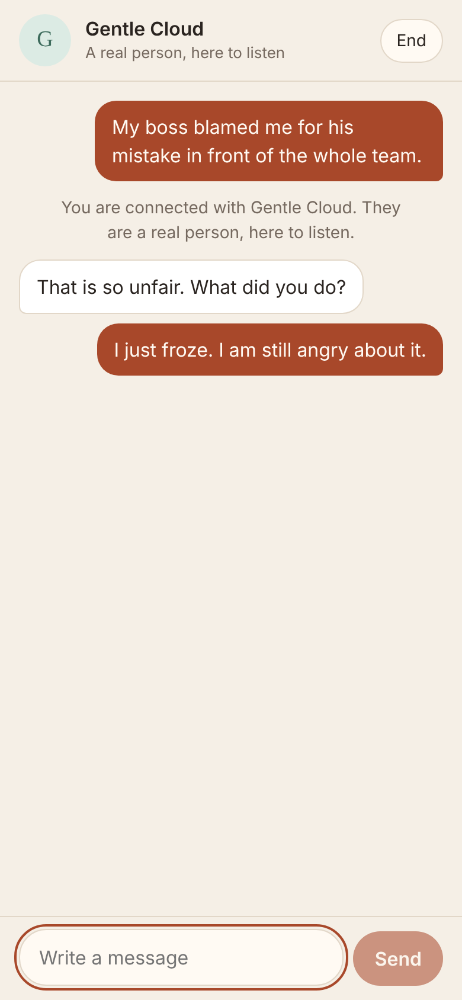

# YENE BET

Vent anonymously to someone who is free right now and can relate. One pool of
people, reachable from a website and a Telegram bot.

- Pick a side each time: **I need to vent** or **I am here to listen**.
- A venter writes a line or two and is connected to the best available
  listener (most shared topics, then longest waiting), or picks from up to three.
- If nobody is free, a clearly labelled AI listener starts at once and a real
  person is offered as soon as one is available. The person who joins sees the
  first message only, never the conversation with the AI.
- Text only. No accounts, names or phone numbers.

 

## Run it locally

Needs Node 20+ and a Postgres database.

```bash
npm install
```

```bash
cp .env.example .env.local
```

Set `DATABASE_URL` in `.env.local`, then create the tables:

```bash
DATABASE_URL=postgres://... npm run migrate
```

```bash
npm run dev
```

Open http://localhost:3000 in two browser windows (use a private window for
the second, so it is a different anonymous person).

## Tests

```bash
DATABASE_URL=postgres://.../test_db npm test
```

Covers matching order, many venters at once never sharing a listener, the AI
fallback and handoff, Telegram flows against a stand-in Telegram API, crisis and
contact checks, reports, blocking and cleanup.

```bash
npm run build && DATABASE_URL=postgres://.../dev_db npm run e2e
```

Drives real phone-sized browsers through the main journeys and saves
screenshots to `tests/e2e/shots`. Both commands empty the database they are
pointed at, so never aim them at a live one.

## Going live

1. Create a Supabase project, run `npm run migrate` against it, and set
   `DATABASE_URL` to its pooled connection string.
2. Deploy the Next.js app (Vercel or Netlify) with the variables in
   `.env.example`.
3. Telegram: create a bot with @BotFather, set `TELEGRAM_BOT_TOKEN` and
   `TELEGRAM_WEBHOOK_SECRET`, then once:
   `curl -X POST https://<site>/api/telegram/register -H "Authorization: Bearer $CRON_SECRET"`
4. Schedule an hourly call to `/api/cron/cleanup` with the same header. It
   closes silent chats and deletes conversations 7 days after they end
   (reported ones are kept for review).

## How it is put together

| Path | What it does |
| --- | --- |
| `supabase/migrations/0001_init.sql` | Tables, plus `claim_listener`, which hands each free listener to exactly one venter |
| `src/lib/server/chat.js` | Matching, messages, handoff, ending, reports, housekeeping |
| `src/lib/server/aiListener.js` | The AI listener (Claude) and its instructions |
| `src/lib/server/bot.js` | Telegram conversation flow on top of `chat.js` |
| `src/lib/server/delivery.js` | Delivers to a browser or to Telegram |
| `src/lib/safety.js`, `src/lib/topics.js`, `src/lib/strings.js` | Crisis and contact checks, topics, all wording |
| `src/app/page.js` | The whole website flow |
| `src/app/api/*` | Routes the website and Telegram call |

Tables have row-level security enabled with no policies, so only the server
(through `DATABASE_URL`) can read or write them.

## Safety notes for whoever runs this

- Listeners are ordinary people. The app says so and is not a crisis service.
- Wording that suggests danger shows a help card pointing to local emergency
  services and findahelpline.com. Add a verified local line with `HELPLINE_TEXT`.
- Reports end the chat and block the pair; three different reporters suspend an
  identity. Reported chats are kept in the `reports` and `chats` tables for a
  human to review; there is no admin screen yet.
